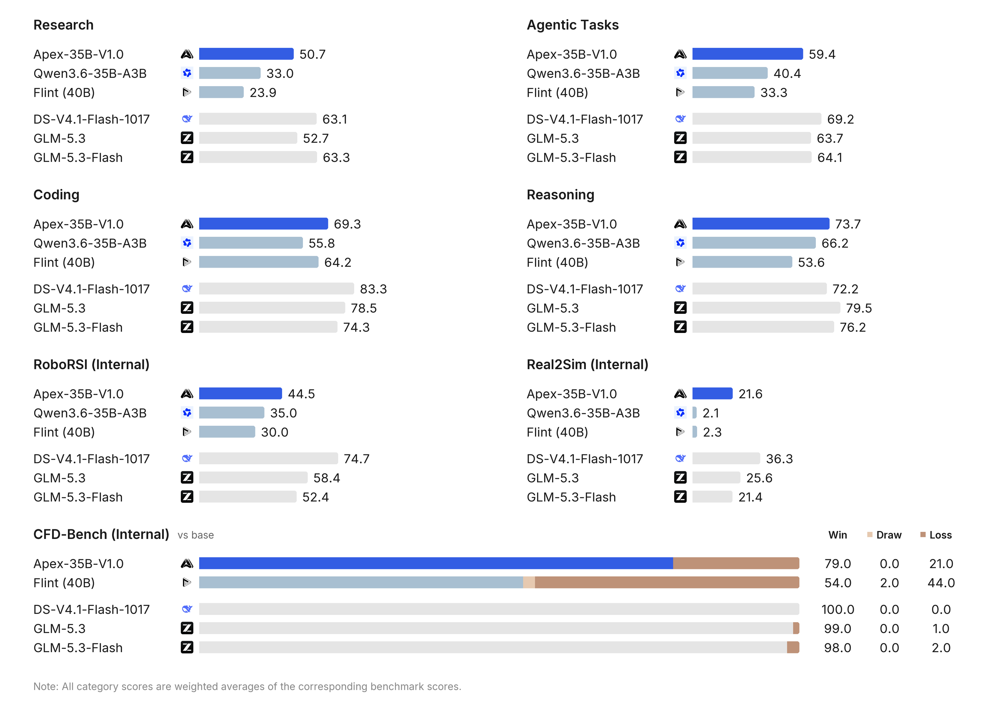

<div align="center">
  <picture>
    <source media="(prefers-color-scheme: dark)" srcset="assets/apex-intelligence-logo-dark.svg">
    
  </picture>
</div>

<hr>

<div align="center" style="line-height: 1;">
  <a href="https://www.apexin.com/"></a>
  <a href="https://github.com/apexin-ai/Apex-35B-V1.0"></a>
  <a href="https://huggingface.co/Apexintelligence-AI/Apex-35B-V1.0"></a>
</div>
<div align="center" style="line-height: 1;">
  <a href="https://www.apexin.com/apex-35b/"></a>
  <a href="https://x.com/apexin_ai"></a>
  <a href="LICENSE"></a>
</div>

## Model Introduction

**Apex-35B-V1.0** is the first model from **Apex Intelligence**, developed for both general-purpose use and research and supported by the [**Claude Code**](https://github.com/anthropics/claude-code) (v2.1.280 preferred) harness. It combines coding, tool use, question answering, and deep search with research tasks in AI, computational science, and robotics simulation.

Built on [Qwen3.6-35B-A3B](https://huggingface.co/Qwen/Qwen3.6-35B-A3B), the model is further trained on proprietary datasets and research trajectories. Its development incorporates recursive self-improvement (RSI) through **Apex Research**, an automated research system that contributes to training-data construction, automated experiments, training-recipe exploration, GPU kernel optimization, and inference optimization. Validated results from this process feed into subsequent development.

### Key Features

- **General and research capabilities.** Covers everyday coding, question answering, search, and agentic tasks, alongside scientific and engineering research workflows.
- **Research through computation and feedback.** Plans computations, writes and runs programs, and uses results or execution feedback to revise its approach, including in fluid dynamics and robotics simulation.
- **Self-improving development.** Apex Research generated training data for the model's weak areas, refined the training recipe based on experimental feedback, and optimized the training and inference infrastructure.
- **Dynamic thinking.** Determines whether to reason and how long to reason on each turn, without manual mode switching.
- **Sparse architecture and long context.** Uses 35B total parameters with approximately 3B activated per token, and a context window of 262,144 tokens shared by input and output, supporting large code repositories and long multi-turn tool interactions.

## Evaluation Results

### Performance Overview

The chart below summarizes performance across four task categories and three internal benchmarks. Apex-35B-V1.0 is highlighted in blue.

- **Category averages:** Research, Agentic Tasks, Coding, and Reasoning show weighted averages of the benchmark scores within each category.
- **Internal benchmarks:** RoboRSI and Real2Sim show individual benchmark scores; CFD-Bench shows wins, draws, and losses against Qwen3.6-35B-A3B.

<p align="center">
  <a href="assets/evaluation-overview.png"></a>
</p>

### Detailed Benchmark Results

The table below provides the per-benchmark breakdown, grouped by task category, followed by the three internal benchmarks.

- **SciCode:** The two scores are **Main Problem / Subproblem**, in that order.
- **CFD-Bench:** Values are **Wins / Draws / Losses** against Qwen3.6-35B-A3B. **N/A** marks the baseline model for this comparison.

<div align="center" style="max-width: 100%; overflow-x: auto;">
<table align="center" style="margin-left: auto; margin-right: auto;">
  <thead>
    <tr>
      <th align="left" scope="col" width="168" style="vertical-align: middle; text-align: left;">Benchmark</th>
      <th align="center" scope="col" width="92" nowrap title="Apex-35B-V1.0 — 35B parameters" style="vertical-align: middle; text-align: center;">Apex-35B<br><sub>V1.0 · Ours</sub><br><sub>35B</sub></th>
      <th align="center" scope="col" width="92" nowrap title="Qwen3.6-35B-A3B — 35B parameters" style="vertical-align: middle; text-align: center;">Qwen3.6<br><sub>35B-A3B</sub><br><sub>35B</sub></th>
      <th align="center" scope="col" width="92" nowrap title="Recursive Flint — 39.8B parameters" style="vertical-align: middle; text-align: center;">Recursive<br><sub>Flint</sub><br><sub>39.8B</sub></th>
      <th align="center" scope="col" width="92" nowrap title="GLM-5.3 — 753B parameters" style="vertical-align: middle; text-align: center;">GLM<br><sub>5.3</sub><br><sub>753B</sub></th>
      <th align="center" scope="col" width="92" nowrap title="GLM-5.3-Flash — 320B parameters" style="vertical-align: middle; text-align: center;">GLM<br><sub>5.3-Flash</sub><br><sub>320B</sub></th>
      <th align="center" scope="col" width="92" nowrap title="DeepSeek-V4.1-Flash-1017 — 552B backbone + 196B Engram memory parameters" style="vertical-align: middle; text-align: center;">DeepSeek<br><sub>V4.1-Flash-1017</sub><br><sub>552B&nbsp;+&nbsp;196B</sub></th>
    </tr>
  </thead>
  <tbody>
    <tr><th colspan="7" align="center" style="vertical-align: middle; text-align: center;">Research</th></tr>
    <tr><td align="left" style="vertical-align: middle; text-align: left;">SciCode<br><sub>Main Problem /<br>Subproblem</sub></td><td align="center" style="vertical-align: middle; text-align: center;"><strong>62.6 /<br>75.6</strong></td><td align="center" style="vertical-align: middle; text-align: center;">37.5 /<br>60.6</td><td align="center" style="vertical-align: middle; text-align: center;">26.6 /<br>46.0</td><td align="center" style="vertical-align: middle; text-align: center;">79.2 /<br>91.3</td><td align="center" style="vertical-align: middle; text-align: center;">76.6 /<br>86.8</td><td align="center" style="vertical-align: middle; text-align: center;">68.8 /<br>81.9</td></tr>
    <tr><td align="left" style="vertical-align: middle; text-align: left;">FrontierScience</td><td align="center" style="vertical-align: middle; text-align: center;"><strong>40.0</strong></td><td align="center" style="vertical-align: middle; text-align: center;">21.7</td><td align="center" style="vertical-align: middle; text-align: center;">5.0</td><td align="center" style="vertical-align: middle; text-align: center;">30.7</td><td align="center" style="vertical-align: middle; text-align: center;">50.0</td><td align="center" style="vertical-align: middle; text-align: center;">61.7</td></tr>
    <tr><td align="left" style="vertical-align: middle; text-align: left;">ASI-Bench</td><td align="center" style="vertical-align: middle; text-align: center;"><strong>22.5</strong></td><td align="center" style="vertical-align: middle; text-align: center;">16.3</td><td align="center" style="vertical-align: middle; text-align: center;">17.5</td><td align="center" style="vertical-align: middle; text-align: center;">33.1</td><td align="center" style="vertical-align: middle; text-align: center;">37.4</td><td align="center" style="vertical-align: middle; text-align: center;">38.9</td></tr>
    <tr><td align="left" style="vertical-align: middle; text-align: left;">BioMysteryBench<br><sub>Human-solvable</sub></td><td align="center" style="vertical-align: middle; text-align: center;"><strong>76.7</strong></td><td align="center" style="vertical-align: middle; text-align: center;">53.4</td><td align="center" style="vertical-align: middle; text-align: center;">49.3</td><td align="center" style="vertical-align: middle; text-align: center;">85.6</td><td align="center" style="vertical-align: middle; text-align: center;">87.7</td><td align="center" style="vertical-align: middle; text-align: center;">86.3</td></tr>
    <tr><td align="left" style="vertical-align: middle; text-align: left;">BioMysteryBench<br><sub>Human-difficult</sub></td><td align="center" style="vertical-align: middle; text-align: center;"><strong>35.3</strong></td><td align="center" style="vertical-align: middle; text-align: center;">11.8</td><td align="center" style="vertical-align: middle; text-align: center;">5.9</td><td align="center" style="vertical-align: middle; text-align: center;">39.1</td><td align="center" style="vertical-align: middle; text-align: center;">41.2</td><td align="center" style="vertical-align: middle; text-align: center;">29.4</td></tr>
    <tr><td align="left" style="vertical-align: middle; text-align: left;">PaperBench</td><td align="center" style="vertical-align: middle; text-align: center;"><strong>60.9</strong></td><td align="center" style="vertical-align: middle; text-align: center;">45.8</td><td align="center" style="vertical-align: middle; text-align: center;">29.3</td><td align="center" style="vertical-align: middle; text-align: center;">42.5</td><td align="center" style="vertical-align: middle; text-align: center;">81.8</td><td align="center" style="vertical-align: middle; text-align: center;">87.1</td></tr>
    <tr><th colspan="7" align="center" style="vertical-align: middle; text-align: center;">Agentic Tasks</th></tr>
    <tr><td align="left" style="vertical-align: middle; text-align: left;">BrowseComp</td><td align="center" style="vertical-align: middle; text-align: center;"><strong>69.4</strong></td><td align="center" style="vertical-align: middle; text-align: center;">42.1</td><td align="center" style="vertical-align: middle; text-align: center;">23.2</td><td align="center" style="vertical-align: middle; text-align: center;">80.9</td><td align="center" style="vertical-align: middle; text-align: center;">81.0</td><td align="center" style="vertical-align: middle; text-align: center;">90.5</td></tr>
    <tr><td align="left" style="vertical-align: middle; text-align: left;">WideSearch</td><td align="center" style="vertical-align: middle; text-align: center;"><strong>69.9</strong></td><td align="center" style="vertical-align: middle; text-align: center;">60.9</td><td align="center" style="vertical-align: middle; text-align: center;">48.3</td><td align="center" style="vertical-align: middle; text-align: center;">78.4</td><td align="center" style="vertical-align: middle; text-align: center;">81.1</td><td align="center" style="vertical-align: middle; text-align: center;">79.8</td></tr>
    <tr><td align="left" style="vertical-align: middle; text-align: left;">BFCL V4</td><td align="center" style="vertical-align: middle; text-align: center;"><strong>84.0</strong></td><td align="center" style="vertical-align: middle; text-align: center;">75.2</td><td align="center" style="vertical-align: middle; text-align: center;">65.4</td><td align="center" style="vertical-align: middle; text-align: center;">75.8</td><td align="center" style="vertical-align: middle; text-align: center;">73.9</td><td align="center" style="vertical-align: middle; text-align: center;">75.0</td></tr>
    <tr><td align="left" style="vertical-align: middle; text-align: left;">AutomationBench</td><td align="center" style="vertical-align: middle; text-align: center;"><strong>49.3</strong></td><td align="center" style="vertical-align: middle; text-align: center;">10.0</td><td align="center" style="vertical-align: middle; text-align: center;">9.8</td><td align="center" style="vertical-align: middle; text-align: center;">50.2</td><td align="center" style="vertical-align: middle; text-align: center;">48.8</td><td align="center" style="vertical-align: middle; text-align: center;">60.5</td></tr>
    <tr><td align="left" style="vertical-align: middle; text-align: left;">APEX-Agents</td><td align="center" style="vertical-align: middle; text-align: center;"><strong>64.6</strong></td><td align="center" style="vertical-align: middle; text-align: center;">41.7</td><td align="center" style="vertical-align: middle; text-align: center;">33.8</td><td align="center" style="vertical-align: middle; text-align: center;">68.2</td><td align="center" style="vertical-align: middle; text-align: center;">73.3</td><td align="center" style="vertical-align: middle; text-align: center;">74.2</td></tr>
    <tr><td align="left" style="vertical-align: middle; text-align: left;">Agents’ Last Exam<br><sub>(ALE)</sub></td><td align="center" style="vertical-align: middle; text-align: center;"><strong>19.1</strong></td><td align="center" style="vertical-align: middle; text-align: center;">12.4</td><td align="center" style="vertical-align: middle; text-align: center;">19.1</td><td align="center" style="vertical-align: middle; text-align: center;">28.5</td><td align="center" style="vertical-align: middle; text-align: center;">26.3</td><td align="center" style="vertical-align: middle; text-align: center;">35.4</td></tr>
    <tr><th colspan="7" align="center" style="vertical-align: middle; text-align: center;">Coding</th></tr>
    <tr><td align="left" style="vertical-align: middle; text-align: left;">Terminal-Bench 2.1</td><td align="center" style="vertical-align: middle; text-align: center;"><strong>65.2</strong></td><td align="center" style="vertical-align: middle; text-align: center;">46.1</td><td align="center" style="vertical-align: middle; text-align: center;">59.6</td><td align="center" style="vertical-align: middle; text-align: center;">89.9</td><td align="center" style="vertical-align: middle; text-align: center;">84.3</td><td align="center" style="vertical-align: middle; text-align: center;">90.6</td></tr>
    <tr><td align="left" style="vertical-align: middle; text-align: left;">SWE-bench Pro v2</td><td align="center" style="vertical-align: middle; text-align: center;"><strong>92.4</strong></td><td align="center" style="vertical-align: middle; text-align: center;">72.4</td><td align="center" style="vertical-align: middle; text-align: center;">85.2</td><td align="center" style="vertical-align: middle; text-align: center;">95.8</td><td align="center" style="vertical-align: middle; text-align: center;">94.7</td><td align="center" style="vertical-align: middle; text-align: center;">97.5</td></tr>
    <tr><td align="left" style="vertical-align: middle; text-align: left;">SWE-bench Verified<br><sub>No Internet</sub></td><td align="center" style="vertical-align: middle; text-align: center;"><strong>73.4</strong></td><td align="center" style="vertical-align: middle; text-align: center;">63.8</td><td align="center" style="vertical-align: middle; text-align: center;">74.8</td><td align="center" style="vertical-align: middle; text-align: center;">79.8</td><td align="center" style="vertical-align: middle; text-align: center;">72.2</td><td align="center" style="vertical-align: middle; text-align: center;">82.0</td></tr>
    <tr><td align="left" style="vertical-align: middle; text-align: left;">LiveCodeBench v6</td><td align="center" style="vertical-align: middle; text-align: center;"><strong>82.3</strong></td><td align="center" style="vertical-align: middle; text-align: center;">84.5</td><td align="center" style="vertical-align: middle; text-align: center;">85.1</td><td align="center" style="vertical-align: middle; text-align: center;">78.3</td><td align="center" style="vertical-align: middle; text-align: center;">75.3</td><td align="center" style="vertical-align: middle; text-align: center;">95.7</td></tr>
    <tr><td align="left" style="vertical-align: middle; text-align: left;">SWE-Atlas QnA</td><td align="center" style="vertical-align: middle; text-align: center;"><strong>33.1</strong></td><td align="center" style="vertical-align: middle; text-align: center;">12.1</td><td align="center" style="vertical-align: middle; text-align: center;">16.1</td><td align="center" style="vertical-align: middle; text-align: center;">48.7</td><td align="center" style="vertical-align: middle; text-align: center;">45.2</td><td align="center" style="vertical-align: middle; text-align: center;">50.8</td></tr>
    <tr><th colspan="7" align="center" style="vertical-align: middle; text-align: center;">Reasoning</th></tr>
    <tr><td align="left" style="vertical-align: middle; text-align: left;">MMLU-Pro</td><td align="center" style="vertical-align: middle; text-align: center;"><strong>87.2</strong></td><td align="center" style="vertical-align: middle; text-align: center;">79.0</td><td align="center" style="vertical-align: middle; text-align: center;">70.8</td><td align="center" style="vertical-align: middle; text-align: center;">88.2</td><td align="center" style="vertical-align: middle; text-align: center;">85.5</td><td align="center" style="vertical-align: middle; text-align: center;">68.3</td></tr>
    <tr><td align="left" style="vertical-align: middle; text-align: left;">AA-LCR</td><td align="center" style="vertical-align: middle; text-align: center;"><strong>77.0</strong></td><td align="center" style="vertical-align: middle; text-align: center;">74.0</td><td align="center" style="vertical-align: middle; text-align: center;">59.0</td><td align="center" style="vertical-align: middle; text-align: center;">80.0</td><td align="center" style="vertical-align: middle; text-align: center;">79.0</td><td align="center" style="vertical-align: middle; text-align: center;">87.0</td></tr>
    <tr><td align="left" style="vertical-align: middle; text-align: left;">HLE</td><td align="center" style="vertical-align: middle; text-align: center;"><strong>47.2</strong></td><td align="center" style="vertical-align: middle; text-align: center;">36.2</td><td align="center" style="vertical-align: middle; text-align: center;">18.2</td><td align="center" style="vertical-align: middle; text-align: center;">61.3</td><td align="center" style="vertical-align: middle; text-align: center;">55.3</td><td align="center" style="vertical-align: middle; text-align: center;">42.6</td></tr>
    <tr><td align="left" style="vertical-align: middle; text-align: left;">GPQA Diamond</td><td align="center" style="vertical-align: middle; text-align: center;"><strong>83.3</strong></td><td align="center" style="vertical-align: middle; text-align: center;">75.8</td><td align="center" style="vertical-align: middle; text-align: center;">66.2</td><td align="center" style="vertical-align: middle; text-align: center;">88.4</td><td align="center" style="vertical-align: middle; text-align: center;">84.9</td><td align="center" style="vertical-align: middle; text-align: center;">90.9</td></tr>
    <tr><th colspan="7" align="center" style="vertical-align: middle; text-align: center;">Internal Benchmarks</th></tr>
    <tr><td align="left" style="vertical-align: middle; text-align: left;">RoboRSI</td><td align="center" style="vertical-align: middle; text-align: center;"><strong>44.5</strong></td><td align="center" style="vertical-align: middle; text-align: center;">35.0</td><td align="center" style="vertical-align: middle; text-align: center;">30.0</td><td align="center" style="vertical-align: middle; text-align: center;">58.4</td><td align="center" style="vertical-align: middle; text-align: center;">52.4</td><td align="center" style="vertical-align: middle; text-align: center;">74.7</td></tr>
    <tr><td align="left" style="vertical-align: middle; text-align: left;">Real2Sim</td><td align="center" style="vertical-align: middle; text-align: center;"><strong>21.6</strong></td><td align="center" style="vertical-align: middle; text-align: center;">2.1</td><td align="center" style="vertical-align: middle; text-align: center;">2.3</td><td align="center" style="vertical-align: middle; text-align: center;">25.6</td><td align="center" style="vertical-align: middle; text-align: center;">21.4</td><td align="center" style="vertical-align: middle; text-align: center;">36.3</td></tr>
    <tr><td align="left" style="vertical-align: middle; text-align: left;">CFD-Bench<br><sub>Wins / Draws / Losses<br>vs. Qwen3.6-35B-A3B</sub></td><td align="center" style="vertical-align: middle; text-align: center;"><strong>79&nbsp;/&nbsp;0&nbsp;/&nbsp;21</strong></td><td align="center" style="vertical-align: middle; text-align: center;">N/A</td><td align="center" style="vertical-align: middle; text-align: center;">54&nbsp;/&nbsp;2&nbsp;/&nbsp;44</td><td align="center" style="vertical-align: middle; text-align: center;">99&nbsp;/&nbsp;0&nbsp;/&nbsp;1</td><td align="center" style="vertical-align: middle; text-align: center;">98&nbsp;/&nbsp;0&nbsp;/&nbsp;2</td><td align="center" style="vertical-align: middle; text-align: center;">100&nbsp;/&nbsp;0&nbsp;/&nbsp;0</td></tr>
  </tbody>
</table>
</div>

## Model Summary

<div align="center">
<table align="center">
  <tbody>
    <tr><th align="center" scope="row">Architecture</th><td align="center">Sparse mixture-of-experts (MoE)</td></tr>
    <tr><th align="center" scope="row">Parameters</th><td align="center">35B total · 3B active per token</td></tr>
    <tr><th align="center" scope="row">Context Length</th><td align="center">262,144 tokens (input + output)</td></tr>
    <tr><th align="center" scope="row">Input / Output</th><td align="center">Text / Text</td></tr>
    <tr><th align="center" scope="row">Thinking Mode</th><td align="center">Dynamic</td></tr>
    <tr><th align="center" scope="row">Weight Precision</th><td align="center">BF16</td></tr>
  </tbody>
</table>
</div>

## Deployment

### Download Model

<div align="center" style="max-width: 100%; overflow-x: auto;">
<table align="center" style="margin-left: auto; margin-right: auto;">
  <thead>
    <tr><th align="center">Model</th><th align="center">Download</th><th align="center">Parameters</th><th align="center">Format</th></tr>
  </thead>
  <tbody>
    <tr><td align="center">Apex-35B-V1.0</td><td align="center"><a href="https://huggingface.co/Apexintelligence-AI/Apex-35B-V1.0">🤗 Hugging Face</a></td><td align="center">35B in total, 3B activated</td><td align="center">BF16 safetensors (about 72 GB)</td></tr>
    <tr><td align="center">Apex-35B-V1.0-GGUF</td><td align="center"><a href="https://huggingface.co/Apexintelligence-AI/Apex-35B-V1.0-GGUF">🤗 Hugging Face</a></td><td align="center">35B in total, 3B activated</td><td align="center">GGUF: BF16, Q8_0, Q6_K, Q5_K_M, Q4_K_M</td></tr>
  </tbody>
</table>
</div>

```bash
pip install -U huggingface_hub   # provides the hf command
hf download Apexintelligence-AI/Apex-35B-V1.0 --local-dir Apex-35B-V1.0
```

### Serving Apex-35B-V1.0

Apex-35B-V1.0 can be served with popular inference frameworks through an OpenAI-compatible API. The commands below start an endpoint at `http://localhost:8000/v1` and, except for `transformers serve` and llama.cpp (see their sections), set the served model name to `Apex-35B-V1.0`, which the examples use as `model`. To use local weights, replace `Apexintelligence-AI/Apex-35B-V1.0` with the local directory; the served model name stays the same.

> [!Important]
> The checkpoint includes its own chat template (`chat_template.jinja`). Every framework below loads it automatically (llama.cpp with `--jinja`). Do not pass `--chat-template`, and do not replace it with the Qwen3.6 template: Apex-35B-V1.0 expects the generation prompt to end with `<think>`.

> [!Important]
> The model has a context length of 262,144 tokens, shared by input and output. The BF16 weights take about 72 GB. One GPU with 141 GB or more (for example H20-3e, H200, or B200) runs the model with tensor parallel size 1 and the full context. On H100 NVL (94 GB) we ran SGLang and vLLM with tensor parallel size 2, and TokenSpeed with tensor parallel size 1; on A100 (40 GB) we ran SGLang and vLLM with tensor parallel size 4. On other GPUs with less memory, increase the tensor parallel size. A shorter context saves little memory: the KV cache for the full 262,144 tokens takes about 5.4 GB.

> [!Note]
> The install commands below install CUDA 13 builds (PyTorch for SGLang and Transformers, and the vLLM wheel). We ran them with NVIDIA drivers 580 and 595. On a machine with 4 × A100 40 GB and driver 570 (CUDA 12.8) we observed:
> - vLLM started after reinstalling its CUDA 12.9 build: `uv pip install "vllm==0.32.0+cu129" --extra-index-url https://wheels.vllm.ai/0.32.0/cu129 --reinstall-package vllm`.
> - SGLang and Transformers stopped with "The NVIDIA driver on your system is too old" and ran only after loading NVIDIA's CUDA 13 forward-compatibility package (`cuda-compat-13-0`).
> - SGLang with MTP started, but its first request failed while FlashInfer compiled its kernels; we did not find a fix. We did not test driver 570 on Hopper or Blackwell GPUs.

> [!Tip]
> Install each framework in its own virtual environment. We tested with Python 3.12 (all frameworks) and 3.13 (vLLM and TokenSpeed), for example:
> ```bash
> uv venv --python 3.12 --seed .venv-sglang && source .venv-sglang/bin/activate
> ```
> `--seed` adds `pip` to the environment. Both the `pip install` and the `uv pip install` commands below install into the active environment.

#### SGLang

[SGLang](https://github.com/sgl-project/sglang) `>=0.5.22` is recommended:

```bash
uv pip install "sglang[all]>=0.5.22"
```

- **Standard launch:**

  ```bash
  python -m sglang.launch_server --model-path Apexintelligence-AI/Apex-35B-V1.0 --served-model-name Apex-35B-V1.0 --port 8000 --tp-size 1 --context-length 262144 --reasoning-parser qwen3 --tool-call-parser qwen3_coder
  ```

- **Multi-Token Prediction (MTP):**

  ```bash
  python -m sglang.launch_server --model-path Apexintelligence-AI/Apex-35B-V1.0 --served-model-name Apex-35B-V1.0 --port 8000 --tp-size 1 --context-length 262144 --reasoning-parser qwen3 --tool-call-parser qwen3_coder --speculative-algorithm NEXTN --speculative-num-steps 3 --speculative-eagle-topk 1 --speculative-num-draft-tokens 4
  ```

The first request after startup can take about one minute; later requests are fast.

#### vLLM

[vLLM](https://github.com/vllm-project/vllm) `>=0.32.0` is recommended:

```bash
uv pip install "vllm>=0.32.0" --torch-backend=auto
```

- **Standard launch:**

  ```bash
  vllm serve Apexintelligence-AI/Apex-35B-V1.0 --served-model-name Apex-35B-V1.0 --port 8000 --tensor-parallel-size 1 --max-model-len 262144 --reasoning-parser qwen3 --enable-auto-tool-choice --tool-call-parser qwen3_coder
  ```

- **Multi-Token Prediction (MTP):**

  ```bash
  vllm serve Apexintelligence-AI/Apex-35B-V1.0 --served-model-name Apex-35B-V1.0 --port 8000 --tensor-parallel-size 1 --max-model-len 262144 --reasoning-parser qwen3 --enable-auto-tool-choice --tool-call-parser qwen3_coder --speculative-config '{"method":"mtp","num_speculative_tokens":2}'
  ```

vLLM returns the thinking in the `reasoning` field instead of `reasoning_content`. The first start can download and compile kernels, which needs internet access and several minutes.

#### TokenSpeed

[TokenSpeed](https://github.com/lightseekorg/tokenspeed) supports NVIDIA Hopper and Blackwell GPUs with CUDA 13. Install the tested nightly build:

```bash
pip install "tokenspeed==0.1.1.post20261025" --extra-index-url https://lightseek.org/whl/nightly --extra-index-url https://lightseek.org/whl/nightly/cu130
```

- **Standard launch:**

  ```bash
  tokenspeed serve Apexintelligence-AI/Apex-35B-V1.0 --served-model-name Apex-35B-V1.0 --port 8000 --tensor-parallel-size 1 --max-model-len 262144 --reasoning-parser qwen3 --tool-call-parser qwen_coder
  ```

- **Multi-Token Prediction (MTP):**

  ```bash
  tokenspeed serve Apexintelligence-AI/Apex-35B-V1.0 --served-model-name Apex-35B-V1.0 --port 8000 --tensor-parallel-size 1 --max-model-len 262144 --reasoning-parser qwen3 --tool-call-parser qwen_coder --speculative-algorithm MTP --speculative-num-steps 3 --speculative-eagle-topk 1 --speculative-num-draft-tokens 4
  ```

This is the nightly build we tested (2026-10-25); later builds may behave differently. The pin covers only the `tokenspeed` package; its dependencies come from the nightly index on the day you install. With `uv pip install`, add `--index-strategy unsafe-best-match` so that uv takes packages from both indexes. In TokenSpeed the tool-call parser is named `qwen_coder`, not `qwen3_coder`. Without the two parser flags, the thinking and the tool calls stay in `content`. The first start compiles kernels, which can take 15 to 25 minutes; later starts reuse the cache. During startup each GPU process used about 280 GiB (300 GB) of host memory in our tests, so tensor parallel size 2 needs about 560 GiB (600 GB) or more. On H100 NVL, tensor parallel size 2 stopped at startup with "an illegal memory access was encountered" in our test; tensor parallel size 1 on one H100 NVL worked.

#### KTransformers

[KTransformers](https://github.com/kvcache-ai/ktransformers) runs the experts on the CPU and the rest of the model on the GPU. Install it as described in its [deployment guide](https://github.com/kvcache-ai/ktransformers/blob/main/doc/en/Qwen3.5.md), download the weights to a local directory, and add the reasoning and tool-call parsers to the launch command:

```bash
python -m sglang.launch_server --model /path/to/Apex-35B-V1.0 --kt-weight-path /path/to/Apex-35B-V1.0 --kt-cpuinfer 32 --kt-threadpool-count 2 --kt-num-gpu-experts 1 --kt-method BF16 --attention-backend triton --trust-remote-code --mem-fraction-static 0.9 --chunked-prefill-size 4096 --max-running-requests 8 --max-total-tokens 32000 --enable-mixed-chunk --tensor-parallel-size 1 --disable-shared-experts-fusion --reasoning-parser qwen3 --tool-call-parser qwen3_coder --served-model-name Apex-35B-V1.0 --port 8000
```

This command is based on the KTransformers guide, with the parsers, served model name and port added. `--max-total-tokens 32000` limits the KV cache to about 32,000 tokens, so a request cannot use the 65,536-token output budget from the examples. For longer prompts and outputs, raise `--max-total-tokens` or lower `max_tokens` in the request.

With `kt-kernel` / `sglang-kt` 0.7.2 we also needed these packages:

```bash
pip install nvidia-cudnn-cu12==9.16.0.29
# Hopper and Ampere GPUs (tested: H20, H200, H100 NVL, A100):
pip install --no-deps sgl-kernel==0.3.21
# Blackwell GPUs (tested: B200); also add --moe-runner-backend triton to the launch command:
pip install ktransformers==0.7.2
```

#### Hugging Face Transformers

[Transformers](https://github.com/huggingface/transformers) includes a lightweight server for quick tests:

```bash
pip install "transformers[serving]>=5.21.0" pillow torchvision
transformers serve Apexintelligence-AI/Apex-35B-V1.0 --port 8000
```

`pillow` and `torchvision` are needed to load the processor files shipped with the checkpoint. `transformers serve` has no served-model-name option: set `model` in the examples to the path or repository ID that you passed to it. It rejects the `top_k` request field, so remove it from `extra_body`. It does not pass the thinking of earlier turns back to the model; for multi-turn and agent use, prefer SGLang, vLLM, or TokenSpeed. If `GET /v1/models` returns HTTP 500 (`CacheNotFound`), create the `hub` folder under `$HF_HOME`; chat requests are not affected.

#### llama.cpp and Unsloth

GGUF builds (BF16, Q8_0, Q6_K, Q5_K_M, Q4_K_M) for llama.cpp, Unsloth, and other local runtimes are in [Apex-35B-V1.0-GGUF](https://huggingface.co/Apexintelligence-AI/Apex-35B-V1.0-GGUF). For example, with a recent [llama.cpp](https://github.com/ggml-org/llama.cpp) build (`llama-server` on `PATH`):

```bash
hf download Apexintelligence-AI/Apex-35B-V1.0-GGUF Apex-35B-V1.0-Q4_K_M.gguf --local-dir .
llama-server -m Apex-35B-V1.0-Q4_K_M.gguf --jinja -ngl 99 -c 32768 --port 8000 --temp 1.0 --top-p 0.95 --top-k 20 --min-p 0.0
```

`--jinja` is required: it applies the chat template embedded in the file. `-c` sets the context for the prompt and the output together; with `-c 32768`, a long thinking can be cut off before the 65,536-token budget of the examples, so raise `-c` if you have the memory. For Unsloth and the other files, see the [GGUF model card](https://huggingface.co/Apexintelligence-AI/Apex-35B-V1.0-GGUF).

### Using Apex-35B-V1.0 via the Chat Completions API

The chat completions API is accessible through standard HTTP requests or the OpenAI SDK. Install the SDK in a separate environment from the server (SGLang 0.5.22 and sglang-kt 0.7.2 require `openai==2.6.1`; upgrading `openai` there breaks that requirement) and configure the endpoint:

```bash
pip install -U openai

# Set the following accordingly
export OPENAI_BASE_URL="http://localhost:8000/v1"
export OPENAI_API_KEY="EMPTY"
```

> [!Tip]
> We recommend `temperature=1.0`, `top_p=0.95`, `top_k=20`, and `max_tokens=65536` (the output budget includes the thinking). The first three values are also the defaults in `generation_config.json`.

> [!Important]
> Apex-35B-V1.0 decides on each turn whether to think and for how long. The thinking is returned in `reasoning_content` (`reasoning` in vLLM) and the answer in `content`. For multi-turn conversations and tool calls, append the complete assistant message to `messages`, for example with `msg.model_dump(exclude_none=True)`, and pass `extra_body={"chat_template_kwargs": {"preserve_thinking": True}}` to keep the thinking of earlier turns. With SGLang, `model_dump()` can print a Pydantic serializer warning about the `metadata` field; it does not change the result.

#### Chat

```python
from openai import OpenAI

client = OpenAI()  # reads OPENAI_BASE_URL and OPENAI_API_KEY

questions = [
    "Water flows through a pipe with an inner diameter of 5 cm at a mean velocity of 2 m/s. Take the kinematic viscosity as 1.0×10⁻⁶ m²/s. "
    "What is the Reynolds number, and is the flow laminar or turbulent? Please answer briefly.",
    "What if the velocity drops to 2 cm/s?",
]

messages = []
for q in questions:
    messages.append({"role": "user", "content": q})
    resp = client.chat.completions.create(
        model="Apex-35B-V1.0",
        messages=messages,
        temperature=1.0,
        top_p=0.95,
        max_tokens=65536,
        extra_body={
            "top_k": 20,
            "chat_template_kwargs": {"preserve_thinking": True},
        },
    )
    choice = resp.choices[0]
    msg = choice.message
    text = (msg.content or "").strip()
    print("Q:", q)
    if choice.finish_reason == "length" or not text:
        print("A: (no complete answer: the output was cut off or empty)")
        break
    print("A:", text, "\n")
    messages.append(msg.model_dump(exclude_none=True))
```

#### Tool Calling

The model calls tools in the Qwen XML format; the tool-call parser of each framework converts the calls into standard `tool_calls`. Return each tool result with `role="tool"` and its `tool_call_id`:

```python
import json
from openai import OpenAI

client = OpenAI()

# kinematic viscosity at 20 °C (m²/s), approximate example values; glycerol means pure glycerol
VISCOSITY = {"water": 1.0e-6, "glycerol": 1.12e-3, "air": 1.5e-5}


def get_fluid_properties(fluid):
    if fluid not in VISCOSITY:
        return {"error": f"unknown fluid: {fluid}", "available": list(VISCOSITY)}
    return {"fluid": fluid, "temperature_C": 20, "kinematic_viscosity_m2_s": VISCOSITY[fluid]}


tools = [{
    "type": "function",
    "function": {
        "name": "get_fluid_properties",
        "description": "Look up the kinematic viscosity of a fluid at 20 °C",
        "parameters": {
            "type": "object",
            "properties": {"fluid": {"type": "string", "enum": list(VISCOSITY)}},
            "required": ["fluid"],
        },
    },
}]

messages = [{"role": "user", "content": (
    "A pipe has an inner diameter of 5 cm and a mean flow velocity of 0.5 m/s. Is the flow laminar or turbulent "
    "when it carries water at 20 °C, and when it carries glycerol at 20 °C? Use get_fluid_properties to look up "
    "the kinematic viscosity, then compute the Reynolds numbers and explain briefly. Answer in plain text, without LaTeX."
)}]
for _ in range(8):  # at most 8 model requests
    resp = client.chat.completions.create(
        model="Apex-35B-V1.0",
        messages=messages,
        tools=tools,
        tool_choice="auto",
        temperature=1.0,
        top_p=0.95,
        max_tokens=65536,
        extra_body={"top_k": 20, "chat_template_kwargs": {"preserve_thinking": True}},
    )
    choice = resp.choices[0]
    msg = choice.message
    messages.append(msg.model_dump(exclude_none=True))
    if choice.finish_reason == "length":  # cut off: do not run partial tool calls
        print("(no complete answer: the output was cut off)")
        break
    if not msg.tool_calls:  # no tool call: require a nonempty final answer
        text = (msg.content or "").strip()
        if not text:
            print("(no complete answer: the output was empty)")
        else:
            print(text)
        break
    for call in msg.tool_calls:
        args = call.function.arguments
        if call.function.name != "get_fluid_properties":
            result = {"error": "unknown tool: " + call.function.name}
        else:
            try:
                args = json.loads(args or "{}")
                result = get_fluid_properties(**args)
            except (json.JSONDecodeError, TypeError) as exc:
                result = {"error": "invalid tool arguments: " + str(exc)}
        print("[tool]", call.function.name, args, "->", result)
        messages.append({"role": "tool", "tool_call_id": call.id, "content": json.dumps(result)})
else:
    print("(reached the limit of 8 requests without a final answer)")
```

## License

Apex-35B-V1.0, including its model weights, code examples, and documentation, is licensed under the [Apache License 2.0](LICENSE).

## Contact

If you have any questions, please reach out at [contact@apexin.ai](mailto:contact@apexin.ai).
